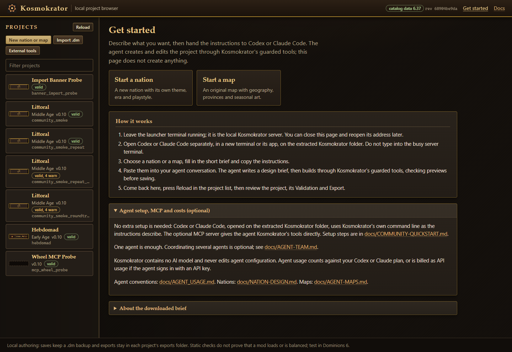

# Kosmokrator

Build **Dominions 6 nations and maps with Codex or Claude Code**, then review, edit
and export them in a local web interface.

Describe your idea. Kosmokrator prepares instructions for your agent and provides
project files, guarded editing tools, reference comparisons and export checks.
The agent creates the content. One agent is enough; no AI model is embedded.

## Start here

You need **Python 3.11 or newer** and access to **Codex or Claude Code**.
Your agent's usual subscription or API charges apply.

1. Extract the source preview ZIP and open PowerShell in its `Kosmokrator` folder.
2. Start the browser:

   ```powershell
   powershell -ExecutionPolicy Bypass -File .\start.ps1
   ```

3. Leave that terminal running. Open Codex or Claude Code separately on the same folder.
4. Choose **Start a nation** or **Start a map** in the browser. Fill in the brief,
   then paste the generated instructions into your agent conversation.
5. When the agent finishes, press **Reload**, review the project and its validation,
   then export the mod or map bundle.

No package installation or Model Context Protocol (MCP) configuration is needed
for this source-folder workflow. The launcher opens <http://127.0.0.1:8765/> and
keeps projects in `work/` by default. Press Ctrl+C in its terminal to stop it.

See the [first-project guide](docs/COMMUNITY-QUICKSTART.md) for other ports and folders,
Python troubleshooting, optional reference data and MCP setup. Non-Windows setup
instructions are included, but have not been verified on a real non-Windows system.



*Example workspace with optional reference data connected. Your project list will differ.*

## What you can make

- **Nations:** recruitment rosters, commanders, pretender gods, magic access,
  sites, national spells and summons, equipment and artwork.
- **Maps:** original geography, land/sea/cave provinces, connections, scenarios,
  and seasonal and terrain image layers. Codex or Claude creates the map files;
  the browser reviews them rather than providing a paint editor.
- **Existing mods:** import a mod into a new project, inspect its contents and
  make supported edits. A project can contain multiple nations and maps.

The browser shows sprites and unit sheets, supports values and traits editing,
and reports inheritance, cross-mod conflicts and balance references. Vanilla
comparisons require a separate, user-supplied
[dom6inspector catalog](docs/COMMUNITY-QUICKSTART.md#optional-add-reference-data).
Optional external-tool handoffs are covered in [tool integrations](docs/TOOL-INTEGRATIONS.md).

## Try an idea

Use these as starting briefs, then adjust the fields in the browser.

**Nation**

> An Early Age Fire/Earth nation inspired by Gnostic mythology. Armoured mortal
> soldiers serve jealous archons. Give it strong forging and durable troops,
> balanced by expensive mages, slow armies and clear counters. Create original
> sprites, a flag and a banner.

**Map**

> A four-player volcanic archipelago with 48 land and 12 sea provinces. Use natural
> province shapes, readable coastlines and fair starting areas. Include winter and
> supported terrain image layers, and review connections and ownership masks.

Prefer a supplied example? The [first-project guide](docs/COMMUNITY-QUICKSTART.md#optional-explore-a-supplied-starter)
explains how to build the lightweight Hebdomad starter. The expanded local showcase
and SevenRealms map are excluded from the source preview and wheel.

## Checks and limits

Edits use revisions, previews and backups. Exports go to new destinations;
Regular exports do not install themselves. Optional guarded local installation is
available through the [Workshop workflow](docs/WORKSHOP.md); publication is manual.

Validation checks files and supported rules. It does **not** prove that a mod
loads, plays correctly or is balanced. Test exports in Dominions 6 separately.
Unknown commands and unresolved mechanics remain marked as unverified.

## Guides

| I want to… | Read |
| --- | --- |
| Make my first nation or map | [First-project guide](docs/COMMUNITY-QUICKSTART.md) |
| Give an agent the authoring rules | [Agent usage](docs/AGENT_USAGE.md) |
| Plan a themed, balanced nation | [Nation design](docs/NATION-DESIGN.md) |
| Create sprites, flags and banners | [Asset rules](docs/ASSET-RULESET.md) |
| Generate and review a map | [Agent maps](docs/AGENT-MAPS.md), [map design](docs/MAP-DESIGN.md), [image layers](docs/MAP-LAYERS.md) |
| Understand the editors and API | [Browser guide](docs/WEB-BROWSER.md) |
| Use commands or inspect project storage | [Command-line reference](docs/CLI-REFERENCE.md) |
| Coordinate optional specialist agents | [Agent team workflow](docs/AGENT-TEAM.md) |
| Check community-preview evidence and gaps | [Readiness](docs/COMMUNITY-READINESS.md) |

## Development

The core uses Python's standard library. MCP is an optional connection that gives
your agent direct access to the tool's operations.
Run the existing tests from the source folder with Python 3.11+:

```powershell
py -3 -m unittest discover -s tests
```

For bug reports, include the command or browser action, expected result, actual
result and Python version. Remove credentials and personal paths from logs.

## License and game resources

Original source code: **GPL-3.0-only**. See [LICENSE](LICENSE) and
[third-party notices](docs/THIRD-PARTY-NOTICES.md) for resource and artwork terms.

Kosmokrator is an independent tool. Dominions 6, its manuals and stock art belong
to Illwinter Game Design. Game binaries, manual PDFs, extracted game icons and the
reference catalog are not bundled. The lightweight starter references vanilla
roster sprites by ID and includes original pretender artwork.
